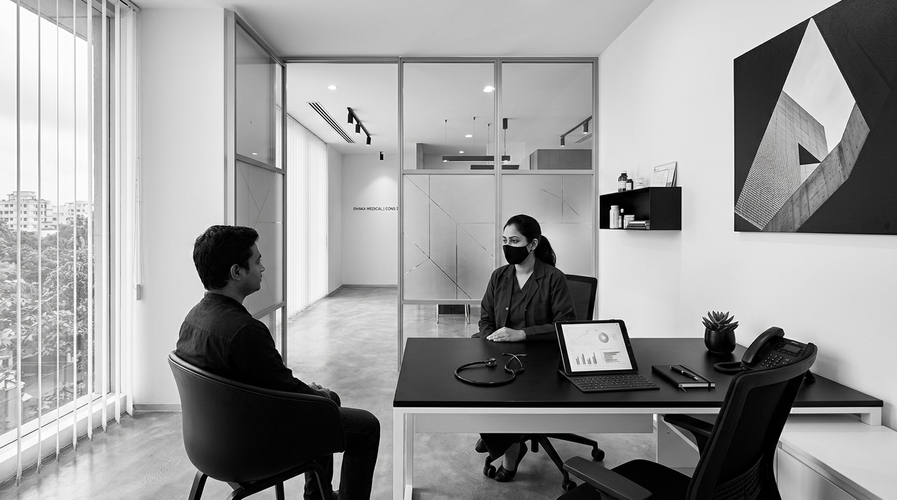
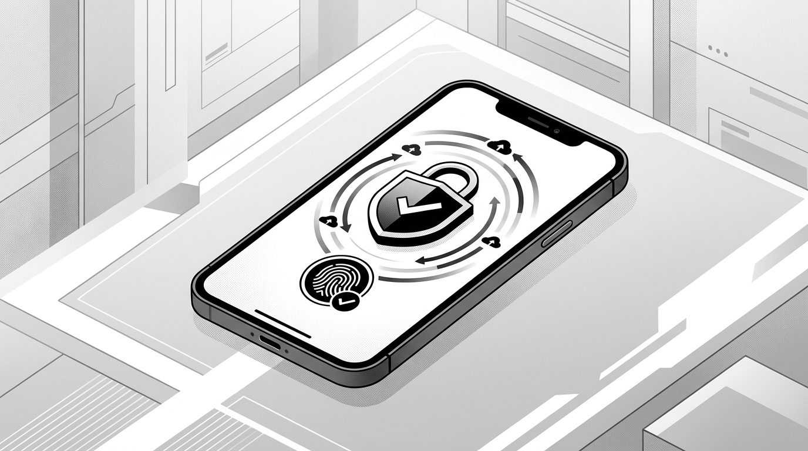
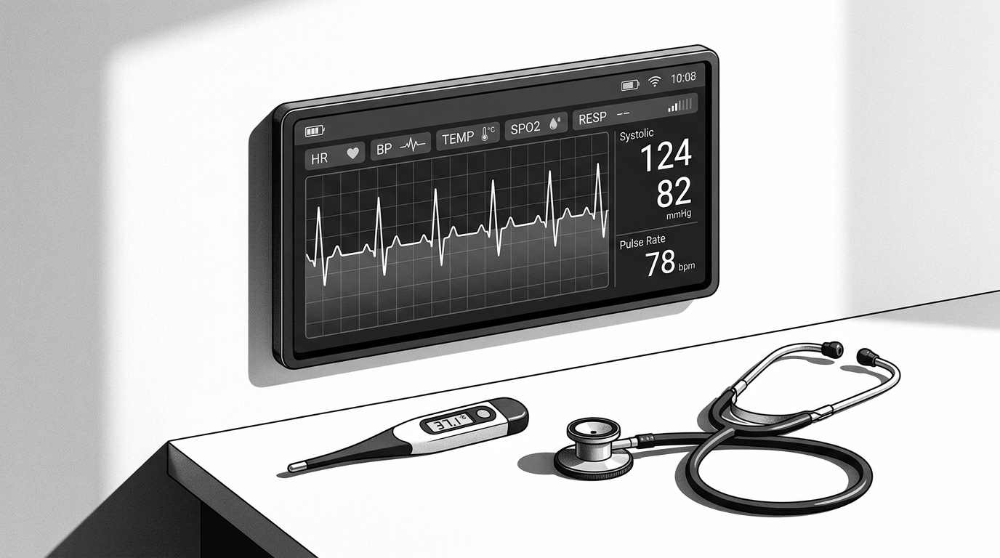
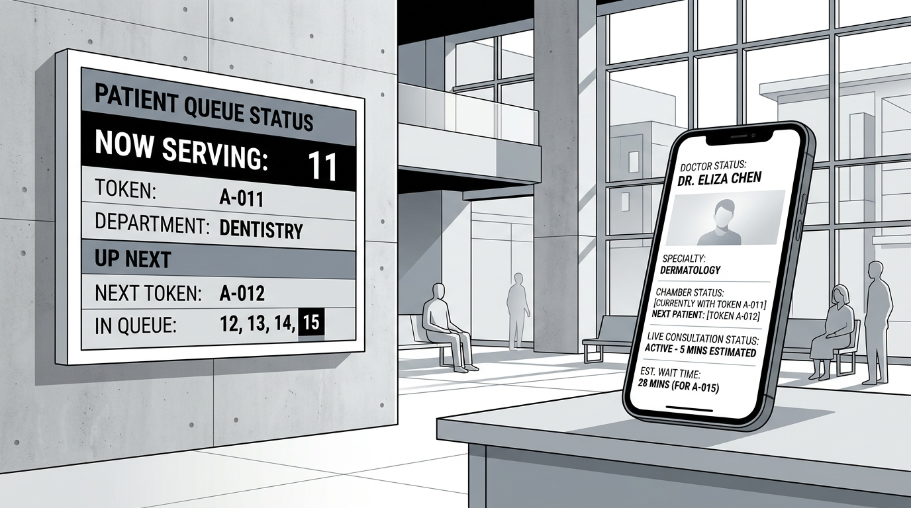
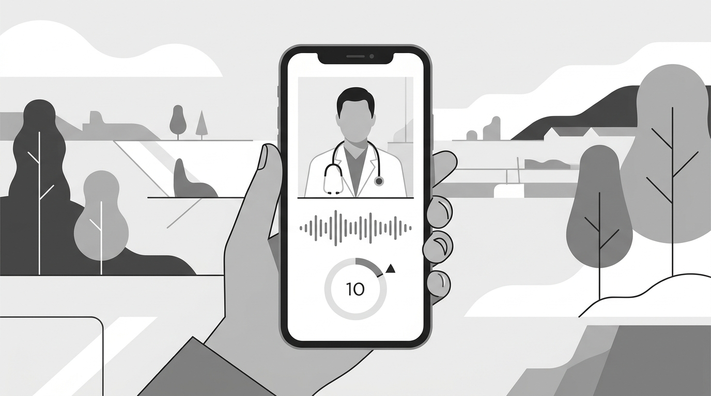
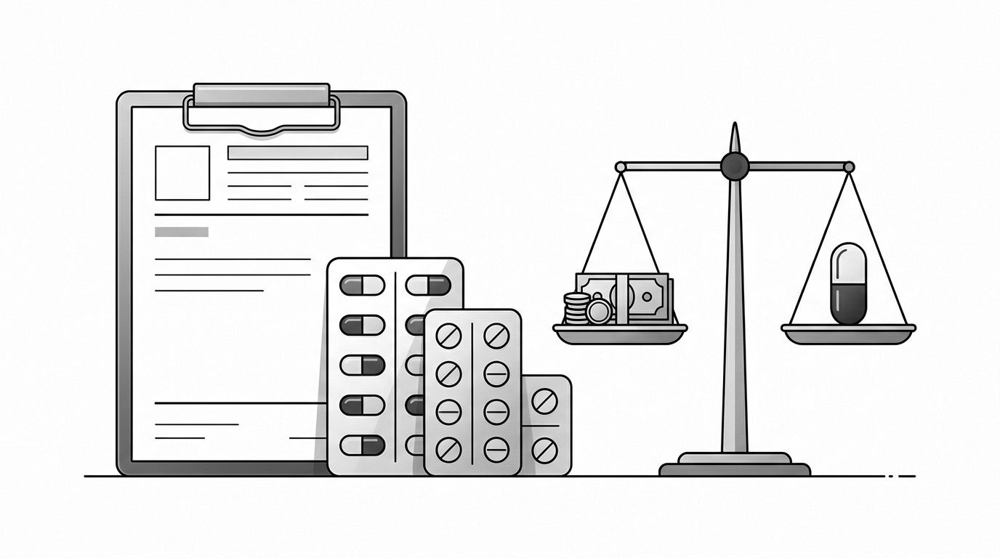
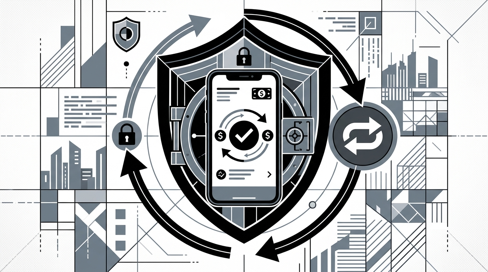
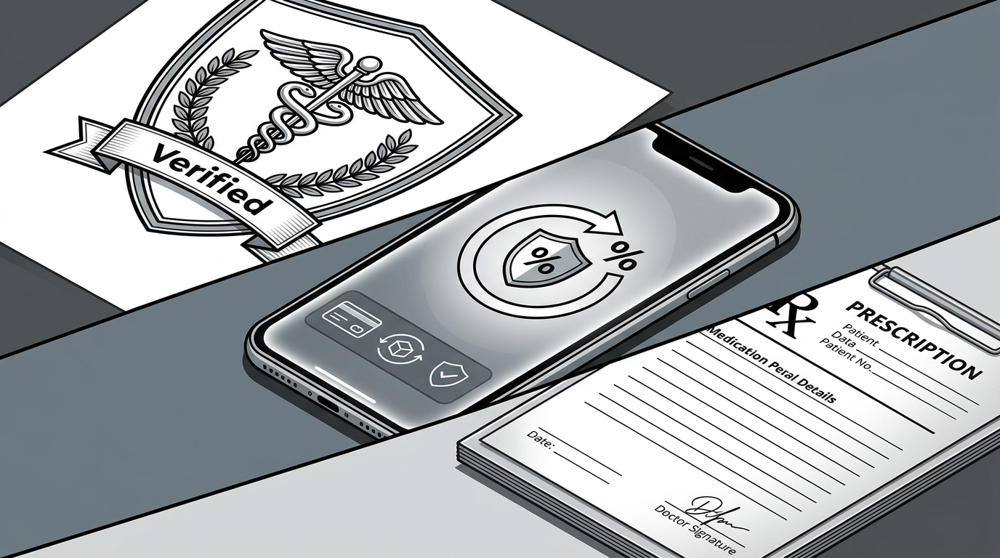
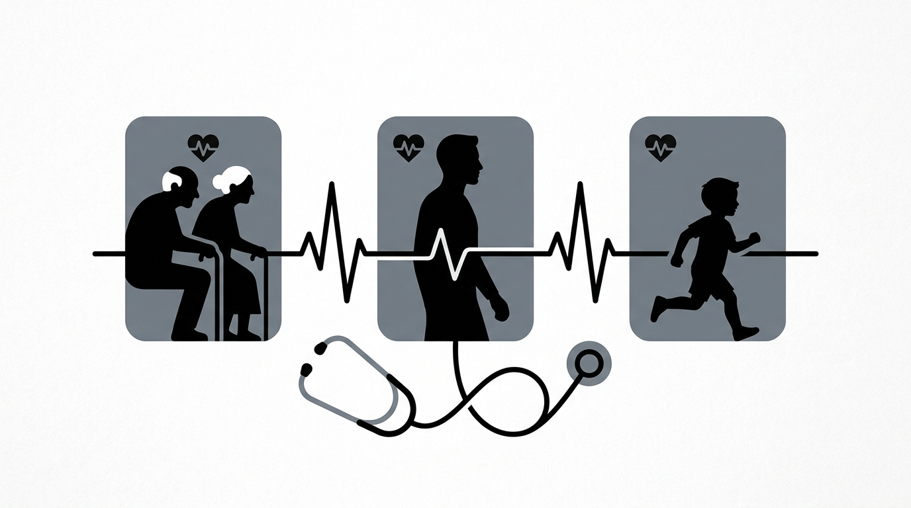
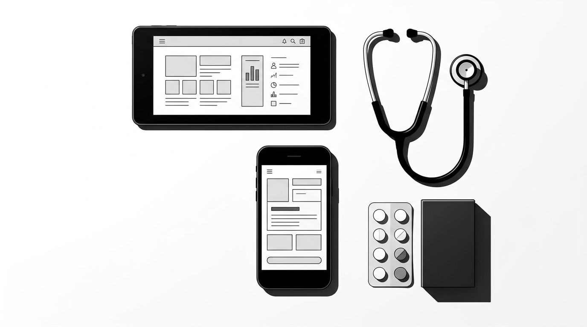

# ShebaDoc (সেবাডক) — Bangladesh Online Doctor Appointment & Telemedicine Platform

> **Engineered & Created by:** **Md Shabbir Mia**

**ShebaDoc (`সেবাডক`)** is a production-grade, bilingual (**বাংলা & English**) Android healthcare application built with **Kotlin**, **Jetpack Compose (Material 3)**, and **Firebase (Authentication + Cloud Firestore)**. Designed with an architectural **Monochrome (White, Black, and Gray)** high-contrast interface, ShebaDoc directly solves the most critical real-world failures reported by patients across Bangladesh telemedicine and hospital serial apps.

---

## Visual Feature Gallery (All 13 Dedicated Image Files in `readme_images/`)

| # | Feature & Patient Protection Solution | Visual Preview (`readme_images/`) |
|---|---|---|
| **01** | **Monochrome Telemedicine Chamber Hero** |  |
| **02** | **ShebaDoc (`সেবাডক`) Monochrome App Identity** |  |
| **03** | **Multi-Channel Auth Security (Google + `+880` Phone + Email/Password)** |  |
| **04** | **Smart Symptom Triage & Pre-Visit Vitals Sync (`BP`, `Temp °F`)** |  |
| **05** | **BMDC Official Verification & 20% Diagnostic Lab Voucher (`SHEBA-LAB20`)** |  |
| **06** | **Specialist Clinical Profile & Credential Inspection** |  |
| **07** | **Live Chamber Serial Queue Tracker (`#11 → #15`) & OT Status** |  |
| **08** | **10-Min Guaranteed SLA Room & 32kbps Low-Data Rural Audio** |  |
| **09** | **Bilingual Digital E-Prescription (`১+০+১`) & DGDA Generic Price Finder** |  |
| **10** | **bKash / Nagad Stuck `TrxID` Self-Recovery Vault** |  |
| **11** | **1-Tap `৳0`-Deduction Instant Escrow Refund Shield** |  |
| **12** | **Multi-Profile Family Health Care (Parents, Spouse & Children)** |  |
| **13** | **Full End-to-End Clinical Workflow & System Architecture** |  |

---

## 1. Online User Review Analysis & Engineered Solutions

We analyzed user reviews and patient complaints across major Bangladesh healthcare platforms (**DocTime**, **Daktarbhai**, **Sebaghar**, **Zaynax Health**, and hospital chamber portals like Square, Evercare, Popular, Ibn Sina, and Labaid). Below is every major pain point discovered and how **ShebaDoc** solves it:

| # | Real Problem Reported by Patients in Bangladesh | Root Cause in Legacy Apps | How ShebaDoc Solves It |
|---|---|---|---|
| **1** | **Doctor No-Show After Payment & 7–14 Day Refund Delays** | Patients pay via bKash/Nagad in advance, the doctor does not join the video call or cancels chamber, and patients wait 5–14 working days for a refund—often losing 20–50 BDT in gateway/cash-out deductions. | **1-Tap Instant 0-BDT Deduction Escrow Refund**: Consultation fees are held in escrow until the visit completes. If a doctor is delayed in Emergency OT or misses the slot, patients can tap **"Doctor No-Show / Delayed → 100% Refund"** in the Live Queue tab to receive an immediate full refund with **৳0 deduction** (enforced at the Firestore Security Rules level via `deductionFeeBdt == 0`). |
| **2** | **bKash / Nagad Money Deducted on Network Timeout Without Serial** | Mobile data drops during MFS checkout; money is deducted from the patient's bKash/Nagad wallet, but the app shows no appointment serial. | **Self-Service Stuck TrxID Recovery Engine**: Patients can enter their bKash/Nagad `TrxID` in the **Stuck TrxID Recovery** modal to immediately verify and restore their serial or claim an instant 100% wallet refund without calling a helpline. |
| **3** | **3–4 Hours Blind Waiting in Crowded Hospital Chambers** | Patients book a "6:00 PM" appointment at Popular, Ibn Sina, or Labaid, arrive on time, and discover the doctor is in Emergency OT or running 25 serials behind. | **Live Chamber Serial & OT Status Tracker**: Real-time token tracking displays the **Current Running Serial** (e.g., `#11`), **Your Serial** (`#15`), **Live Chamber Status** (`IN_CHAMBER`, `ON_TIME`, `DELAYED_20M`, `IN_OT`), and dynamic **Estimated Wait Time (Minutes)**. |
| **4** | **2-Minute Rushed Calls & Video Drops on Weak 3G / Rural Data** | Video consultations freeze on weak mobile data outside Dhaka or inside thick hospital buildings, or doctors end the call in 90 seconds without listening. | **10-Minute SLA Consultation Room & 32kbps Rural Audio Fallback**: Built-in **10:00 Guaranteed SLA Timer** plus 1-tap live switching between **HD Video**, **32kbps Low-Data Rural Audio**, and **In-Chamber Token** mode without losing the active session. |
| **5** | **Expensive Prescribed Medicine Brands & Unreadable Handwritten Rx** | Doctors prescribe expensive brands or out-of-stock medicines, and patients cannot read handwritten Latin abbreviations (`1+0+1`, `BD`, `PC`). | **DGDA Generic Medicine Price Comparator & Bilingual Digital E-Prescription**: Every consultation generates a clear **Bangla + English Digital E-Prescription** (`১+০+১ খাবার পর`), paired with a **DGDA Generic Medicine Comparator** showing exact generic names and unit prices across **Square, Incepta, Beximco, Renata, and Healthcare**. |
| **6** | **BMDC Verification Transparency & Unverified Practitioners** | Patients cannot distinguish between fully verified BMDC specialists and unverified/pending profiles, and get charged a full new-visit fee just to show lab reports within 7 days. | **Realistic BMDC Verification Audit + Safety Guard**: Doctors display transparent BMDC verification states (**5 BMDC Verified** vs. **2 Unverified / Pending Audit Warning** with an informed consent guard in booking and a **"BMDC Verified Only"** filter), plus **50% Follow-Up / Report-Show Fee Lock** and **20% Diagnostic Lab Voucher (`SHEBA-LAB20`)**. |

---

## 2. Core Features Deep-Dive

### A. Multi-Mode Authentication & Bangladesh Patient Identity Hub

- **Phone + Password (`+880 1XXX-XXXXXX`)**: Login using a Bangladesh phone number and account password/PIN synced with Google Cloud authentication.
- **Email + Phone + Password**: Complete multi-credential patient sign-in form with show/hide password toggle and validation.
- **Google Sign-In (`CredentialManager` / `GetSignInWithGoogleOption`)**: One-tap cryptographic cloud authentication backed by Firebase Auth and zero-trust Firestore security rules.

---

### B. Realistic BMDC Registry Audit & Smart Symptom Triage

- Out of 7 specialists in the catalog, **5 doctors are BMDC Verified** and **2 doctors are flagged as Unverified / Pending Audit** (`BMDC-PENDING-51208` and `BMDC-UNVERIFIED-39812`).
- Includes a **BMDC Verified Only / Unverified Audit** filter bar, interactive certificate inspection modal, and an informed consent checkbox inside the booking dialog before anyone can confirm an unverified practitioner.
- **Smart Symptom Triage** matches urgent symptoms (Chest Pain, High Fever/Dengue, Pregnancy Care, Pediatric Cough, Migraine, Joint Pain) directly to verified specialists.

---

### C. Live Chamber Queue & 10-Min Consultation SLA Room (Tab 1)

- Real-time Firestore listener on `/users/{userId}/appointments/{appointmentId}`.
- Live progress comparison between **Current Running Serial** vs. **Your Serial Token**.
- **10-Minute SLA Consultation Room**: Countdown timer + live mode switching (`VIDEO` / `AUDIO_LOW_DATA` / `CHAMBER`).
- **Pre-Visit Vitals Editor**: Update Blood Pressure (`mmHg`), Temperature (`°F`), and Chief Complaints before entering the chamber or call.
- **1-Tap Doctor No-Show Instant Refund**: Creates an immutable `RefundClaim` record with `deductionFeeBdt = 0`.

---

### D. Digital E-Prescriptions, DGDA Generic Medicine Finder & Review Solutions (Tab 2)

- Bilingual (`বাংলা` & `English`) E-Prescriptions with structured morning-noon-night (`১+০+১`) dosage schedules, clinical advice, recommended lab tests, and a `20% Lab Discount Coupon (SHEBA-LAB20)`.
- **DGDA Generic Medicine Price & Alternative Brand Comparator**: Search by brand or generic name (`Esomeprazole`, `Bisoprolol`, `Amlodipine`, `Rosuvastatin`, `Naproxen`, `Bilastine`) to compare unit prices in BDT across top Bangladesh pharmaceutical manufacturers.

---

### E. Family Health Profiles & Zero-Deduction MFS Protection Hub (Tab 3)

- Manage multiple family members (**Self, Father, Mother, Child, Spouse**) with blood group, age, and chronic conditions for 1-tap booking.
- **Zero-Deduction Refund & MFS TrxID Audit Log**: Real-time Firestore stream of all instant refunds and recovered bKash/Nagad transactions.

---

## 3. Architecture, Design System & Verification

- **Author & Lead Engineer**: **Md Shabbir Mia**
- **Language & UI**: 100% Kotlin + Jetpack Compose (Material 3) with adaptive responsive containers (`widthIn(max = 680.dp)` / `760.dp`), custom bilingual typography (`Space Grotesk` & `Plus Jakarta Sans`), and Edge-to-Edge insets.
- **Strict Monochrome Design System**: Pure White (`#FFFFFF`), Pitch Black (`#09090B`), and Precision Architectural Grays (`#F4F4F5`, `#E4E4E7`, `#D4D4D8`, `#52525B`, `#27272A`, `#18181B`) for high clinical readability in Light and Dark monochrome themes.
- **Bilingual Engine**: Instant runtime switching between **English (`EN`)** and **Bangla (`বাংলা`)**, including automatic Bengali numeral conversion (`০১২৩৪৫৬৭৮৯`) for fees, serial numbers, and wait times.
- **Cloud Backend & Zero-Trust Security Rules**:
  - **Firebase Authentication** + **Cloud Firestore** (`R.string.firestore_database_id`).
  - **Collections**:
    - `/users/{userId}/appointments/{appointmentId}`
    - `/users/{userId}/prescriptions/{prescriptionId}`
    - `/users/{userId}/family_members/{memberId}`
    - `/users/{userId}/refund_claims/{claimId}` (strictly validates `data.deductionFeeBdt == 0` and `data.createdAt <= request.time`).

### Testing & Verification

- **Tier 1 Firestore Rules Tests (`firestore.test.js`)**: Validates schema enforcement, owner isolation, and zero-deduction refund rules against the local Firestore Emulator.
- **Tier 2 Kotlin Robolectric Tests (`ShebaRepositoryRuleTest.kt`)**: Validates end-to-end repository operations (`bookAppointment`, `triggerDoctorNoShowInstantRefund`, `reconcileStuckMfsTransaction`, cross-user `PERMISSION_DENIED`, and unauthenticated access rejection).
